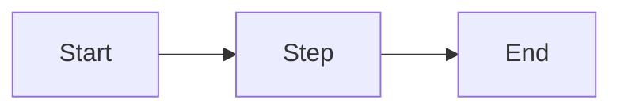

# Markdown Cheat Sheet

A reference for Markdown. Each entry shows what the feature does, the Markdown source and the rendered result.

- **CommonMark**: works in the [CommonMark dingus](https://spec.commonmark.org/dingus/) and on GitHub
- **GitHub**: works on GitHub only

Labels tested on: [date]

## Contents

- [Text](#text)
- [Lists](#lists)
- [Links and images](#links-and-images)
- [Code](#code)
- [Quotes](#quotes)
- [Tables](#tables)
- [Layout](#layout)
- [GitHub extras](#github-extras)
- [Pitfalls](#pitfalls)

---

## Text

### Headings

**CommonMark** · One to six `#` create a heading. More `#` means a smaller heading.

```markdown
##### Small heading
###### Smallest heading
```

##### Small heading
###### Smallest heading

### Paragraphs and line breaks

**CommonMark** · A blank line separates paragraphs. A `\` at the end of a line creates a line break inside a paragraph.

```markdown
First line\
second line in the same paragraph.

New paragraph.
```

First line\
second line in the same paragraph.

New paragraph.

### Italic, bold and both

**CommonMark** · One asterisk for italic, two for bold, three for both.

```markdown
*italic* · **bold** · ***bold and italic***
```

*italic* · **bold** · ***bold and italic***

### Strikethrough

**GitHub** · Two tildes on each side cross text out.

```markdown
~~no longer true~~
```

~~no longer true~~

### Inline code

**CommonMark** · Backticks mark code inside a sentence.

```markdown
Use `print()` to show output.
```

Use `print()` to show output.

### Escaping a character

**CommonMark** · A backslash shows a character as it is instead of using it for formatting.

```markdown
\*not italic\*
```

\*not italic\*

---

## Lists

### Unordered, ordered and nested lists

**CommonMark** · `-` for bullet points, `1.` for numbers. Indent to nest.

```markdown
- Fruit
  - Apple
  - Pear
1. First step
2. Second step
   1. Part a
   2. Part b
```

- Fruit
  - Apple
  - Pear
1. First step
2. Second step
   1. Part a
   2. Part b

### Task lists

**GitHub** · `[ ]` is an open task, `[x]` a finished one.

```markdown
- [x] Done
- [ ] To do
```

- [x] Done
- [ ] To do

---

## Links and images

### Inline link

**CommonMark** · Link text in square brackets, address in round brackets.

```markdown
[CommonMark](https://commonmark.org)
```

[CommonMark](https://commonmark.org)

### Reference-style link

**CommonMark** · The address is defined separately, which keeps the text tidy.

```markdown
Read the [spec][spec].

[spec]: https://spec.commonmark.org
```

Read the [spec][spec].

[spec]: https://spec.commonmark.org

### Relative link to a file in the repository

**CommonMark** · The path starts from the current file. `../` means one folder up.

```markdown
[README](../../README.md)
```

[README](../../README.md)

### Link to a section

**GitHub** · GitHub creates an anchor for each heading: lowercase, spaces become `-`.

```markdown
[Go to Tables](#tables)
```

[Go to Tables](#tables)

### Image with alt text

**CommonMark** · Like a link, with `!` in front. The alt text describes the image.

```markdown

```


### Image that is a link

**CommonMark** · Put the image inside the square brackets of a link.

```markdown
[](https://github.com)
```

[](https://github.com)

---

## Code

### Fenced code blocks with syntax highlighting

**CommonMark** · Three backticks open and close a code block; the language follows the opening backticks. GitHub adds colours, the dingus does not.

````markdown
```python
print("Hello")
```

```bash
ls -l
```

```json
{"name": "example", "value": 1}
```
````

```python
print("Hello")
```

```bash
ls -l
```

```json
{"name": "example", "value": 1}
```

---

## Quotes

### Blockquotes, nested and with formatting

**CommonMark** · `>` creates a quote, `>>` a quote inside a quote. Formatting works inside.

```markdown
> A quote with **bold** text.
>> A *nested* quote.
```

> A quote with **bold** text.
>> A *nested* quote.

### Alerts

**GitHub** · A quote that starts with `[!NOTE]`, `[!TIP]`, `[!IMPORTANT]`, `[!WARNING]` or `[!CAUTION]`.

```markdown
> [!NOTE]
> Useful information.
```

> [!NOTE]
> Useful information.

---

## Tables

### Table with aligned columns, a link and a pipe

**GitHub** · Colons in the separator row set the alignment: left, centre, right. `\|` shows a pipe inside a cell.

```markdown
| Left | Centre | Right |
|:---|:---:|---:|
| [Link](https://example.com) | a \| b | 10 |
| text | text | 200 |
```

| Left | Centre | Right |
|:---|:---:|---:|
| [Link](https://example.com) | a \| b | 10 |
| text | text | 200 |

---

## Layout

### Horizontal rule

**CommonMark** · Three hyphens on their own line, with a blank line before.

```markdown
---
```

---

### Collapsed section

**[label after testing]** · The HTML tags `<details>` and `<summary>` create a section that opens on click.

```markdown
<details>
<summary>Click to open</summary>

Hidden text.

</details>
```

<details>
<summary>Click to open</summary>

Hidden text.

</details>

### Comments that do not render

**CommonMark** · Everything between `<!--` and `-->` stays invisible.

```markdown
Visible <!-- invisible --> visible again.
```

Visible <!-- invisible --> visible again.

---

## GitHub extras

### Footnotes

**GitHub** · `[^1]` in the text; the note appears at the bottom of the page.

```markdown
A sentence with a footnote.[^1]

[^1]: The footnote text.
```

A sentence with a footnote.[^1]

[^1]: The footnote text.

### Emoji shortcodes

**GitHub** · A word between colons becomes an emoji.

```markdown
:smile: :rocket:
```

:smile: :rocket:

### @mentions and issue references

**GitHub** · `@username` links a person, `#1` links issue number 1. [Note where they become links: in a file, in an issue comment, or both.]

```markdown
Thanks @octocat, see #1.
```

Thanks @octocat, see #1.

### Mermaid diagram

**GitHub** · A code block with the language `mermaid` is drawn as a diagram.

````markdown

````


### Formula

**GitHub** · `$...$` inside text, `$$...$$` on its own lines.

```markdown
Inline: $a^2 + b^2 = c^2$

$$
\frac{x}{y}
$$
```

Inline: $a^2 + b^2 = c^2$

$$
\frac{x}{y}
$$

---

## Pitfalls

1. **Strikethrough and task lists show as plain text in the dingus.** `~~` and `[x]` are GitHub extensions, not part of CommonMark. Fix: label them GitHub.
2. **Links to sections do not jump in the dingus.** Only GitHub creates anchors for headings. Fix: test section links on GitHub.
3. **@mentions are not linked in a file.** They only become links in issues and comments. Fix: test them in an issue.
