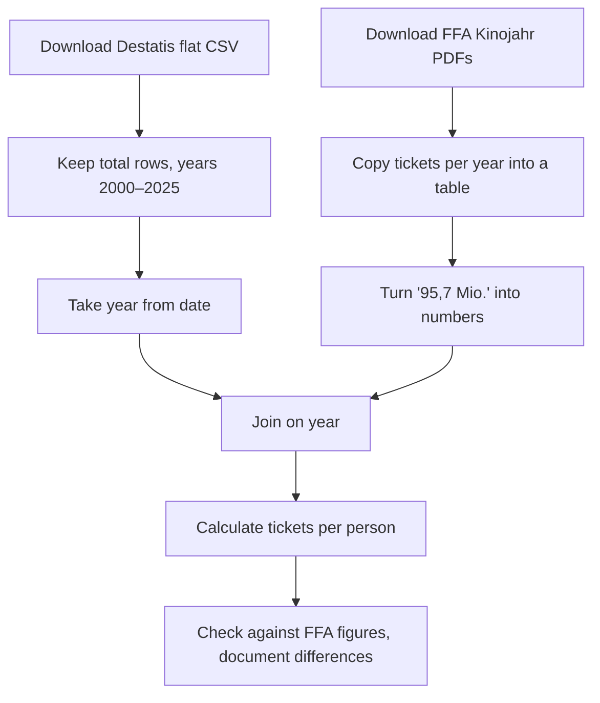

# Dataset profile

## Task 5 · Find a dataset

### Where I searched

| Source | Kind | Search terms | What I found |
|---|---|---|---|
| [FFA Filmförderungsanstalt](https://www.ffa.de/broschueren.html) | publisher website | Kinojahr, Kinobesucher | Cinema tickets, revenue and audience 2000–2025, but only as PDF and without an open licence |
| [GENESIS-Online (Destatis)](https://genesis.destatis.de) | national statistics database | Fortschreibung des Bevölkerungsstandes | Population of Germany per year, as CSV under an open licence |
| [GovData](https://www.govdata.de) | national open data portal | kino | 133 datasets, see below |
| [Open.NRW](https://open.nrw) | state open data portal | kino | 33 datasets, see below |

### Search like a machine

| API | Hits (`count`) | Title of the first hit | Where the licence is given |
|---|---|---|---|
| [GovData](https://www.govdata.de/ckan/api/3/action/package_search?q=kino&rows=1) | 133 | Kino (Stadt Norderstedt) | `license_id` for the whole dataset is empty, but each file has `license` = Datenlizenz Deutschland – Namensnennung 2.0. Also, `isopen` is `false` although the files are openly licensed, so the field is not reliable. |
| [Open.NRW](https://open.nrw/api/3/action/package_search?q=kino&rows=1) | 33 | POI – Kinos (Regionalverband Ruhr) | `license_id` for the whole dataset: `other-closed` ("Andere geschlossene Lizenz"), so the data is not open. |

Searched on 24.10.2026. Both first hits are about cinema locations, not cinema visits, so they do not fit our research questions.

### My choice

I chose **Bevölkerung: Deutschland, Stichtag, Geschlecht (12411-0003)** from [Destatis](https://genesis.destatis.de/datenbank/online/statistic/12411/table/12411-0003). Destatis is the original publisher, the data can be downloaded as CSV, and it is under an open licence. It contains the total population per year (which we need to calculate cinema visits per person) and the population by sex. A shorter table with the total only also exists ([12411-0001](https://genesis.destatis.de/datenbank/online/statistic/12411/table/12411-0001), from 1950).

The cinema data of the FFA would fit our topic better, but it is only available as PDF and not openly licensed, so it cannot be the base of an open dataset.

## Task 6 · Profile the dataset

### Facts

| | Bevölkerung: Deutschland, Stichtag, Geschlecht |
|---|---|
| Publisher | Statistisches Bundesamt (Destatis), original publisher, on [GENESIS-Online](https://genesis.destatis.de) |
| Identifier | Table `12411-0003`, statistic `12411` (Fortschreibung des Bevölkerungsstandes) |
| Formats | CSV (table layout) and flat CSV (one value per row), each as ZIP download |
| Size | Table CSV: 1 file, 56 data rows (years), 7 columns (date, then value and quality flag for male, female, total). Flat CSV: 1 file, 168 rows (56 years × 3), 18 columns |
| Coverage | Germany, 31.12.1970 to 31.12.2025, one value per year (reference date 31 December), by sex |
| Last update | "Stand: 22.10.2026" in the file; updated once a year |
| Licence | [Datenlizenz Deutschland – Namensnennung – Version 2.0](https://www.govdata.de/dl-de/by-2-0) (GENESIS-Online → Impressum → Copyright) |

### Stars

★★★ The data is openly licensed (★), structured and machine-readable (★★) and in a non-proprietary format, CSV (★★★). For the 4th star, the data would need URIs that identify things, e.g. a link for "Germany" or "male" instead of plain text, so that others can point to it.

### Open the data

I downloaded both CSV files and opened them in Microsoft Excel.

| Column | Minimum | Maximum | Mean |
|---|---|---|---|
| male | 29,071,621 (1970) | 41,241,701 (2024) | 36,349,261 |
| female | 31,818,689 (1987) | 42,335,439 (2024) | 38,399,631 |
| total | 61,001,164 (1970) | 83,577,140 (2024) | 74,748,892 |

**Empty cells:** in the flat CSV, the column `2_variable_attribute_code` is empty in 56 of 168 rows, always in the rows for "Insgesamt" (total). In the table CSV, no data cell is empty.

**Odd things I noticed:**
- The file is UTF-8 with a BOM, uses `;` as separator and has no decimal numbers.
- The table CSV starts with 7 lines of titles before the data and ends with footnotes and a copyright line, so it cannot be read as a plain table. The flat CSV has one clean header row.
- Dates are written as `31.12.1970` in the table CSV and as `1970-12-31` (ISO 8601) in the flat CSV. The flat CSV is not sorted by year.
- Each value has a quality flag; all flags are `e`.
- **Breaks in the series:** until 1989 the numbers cover only West Germany ("Bis 1989: Früheres Bundesgebiet"), so the total jumps from 62.7 million (1989) to 79.8 million (1990). After the census 2011 the total drops from 81.8 million (2010) to 80.3 million (2011); the census 2022 also changes the basis.
- male + female = total in every row.
- When I opened the table CSV in Excel, it turned the dates into Excel dates and showed only two digits for the year (`31.12.25`).

### Data dictionary (flat CSV)

| Column | Meaning | Type and unit | Example |
|---|---|---|---|
| `time` | Reference date | date (ISO 8601) | `2025-12-31` |
| `1_variable_attribute_label` | Area | text | `Deutschland` |
| `2_variable_attribute_label` | Sex | text: `männlich`, `weiblich`, `Insgesamt` | `weiblich` |
| `value` | Population | integer, number of persons | `42282795` |
| `value_q` | Quality flag of the value | text code | `e` |

Destatis explains the statistic and its method on the [statistic page in GENESIS-Online](https://genesis.destatis.de/datenbank/online/statistic/12411/details). There is no separate description of each column; the column names of the flat CSV are mostly self-explanatory, but codes such as `DINSG` or `e` need the GENESIS documentation.

### Licence

The Datenlizenz Deutschland – Namensnennung – Version 2.0 [conforms to the Open Definition](https://opendefinition.org/licenses/), so the dataset is open. When I reuse it, I must name the provider, the licence and a link to the dataset, and say if I changed the data.

**Attribution (TASL):**

> „Bevölkerung: Deutschland, Stichtag, Geschlecht (12411-0003)“, Statistisches Bundesamt (Destatis), [GENESIS-Online](https://genesis.destatis.de/datenbank/online/statistic/12411/table/12411-0003), [Datenlizenz Deutschland – Namensnennung – Version 2.0](https://www.govdata.de/dl-de/by-2-0). Data changed: filtered to 2000–2025.

### People

The dataset contains no personal data: it only has totals for all of Germany per year and sex.

## Task 7 · FAIR review

| Principle | Rating | Evidence |
|---|---|---|
| F1 | ~ | A stable table code (`12411-0003`) and a stable URL on [GENESIS-Online](https://genesis.destatis.de/datenbank/online/statistic/12411/table/12411-0003), but no DOI |
| F2 | ~ | Title, publisher and date ("Stand: 22.10.2026") are given, and the [statistic page](https://genesis.destatis.de/datenbank/online/statistic/12411/details) describes the statistic; I found no keywords |
| F4 | ✓ | Indexed in the GENESIS-Online search (I found it with "Fortschreibung des Bevölkerungsstandes") and listed in the [Geodatenkatalog](https://gdk.gdi-de.org/geonetwork/srv/api/records/30303031-3234-4031-312d-303030330002) |
| A1 | ✓ | Downloaded over HTTPS in the browser, without a login |
| I1 | ✓ | CSV, an open and machine-readable format |
| I2, I3 | ~ | The flat CSV uses ISO 8601 dates (`1970-12-31`), but Germany is coded as `DG`, not ISO 3166 (`DE`); the file does not link to related data or to its sources |
| R1 | ~ | The [statistic page](https://genesis.destatis.de/datenbank/online/statistic/12411/details) has a detailed method description (who is counted, census as basis, updates from registration offices), and the footnotes explain the breaks, but there is no description of each column |
| R1.1 | ~ | The licence is clear (GENESIS imprint) and appears in the catalogue record ("Datenlizenz by-2-0"), but not in the downloaded file itself, which only says "© Statistisches Bundesamt (Destatis), 2026" |
| R1.2 | ✓ | Destatis is the original publisher. The method description explains the provenance: the census (2022) is the basis, updated with data from registration offices (moves) and registry offices (births and deaths) |
| R1.3 | ~ | The metadata is harvested into a catalogue, but I could not check whether it follows DCAT-AP |

**Is it FAIR, open, or both?** The dataset is **open**: it is under a licence that conforms to the Open Definition and can be downloaded without a login. It is **partly FAIR**: it is easy to find and access and machine-readable, but it has no DOI, uses its own codes instead of standard ones, and the licence is not in the file itself.

**Three things I will do better when I publish our dataset for milestone 2:**
1. Give it a persistent identifier, e.g. a DOI via [Zenodo](https://zenodo.org).
2. Add a data dictionary that describes every column, with type and unit.
3. Put the licence in a `LICENSE` file and in the metadata, and use standard codes (ISO 8601 dates, ISO 3166 country codes).

## Task 8 · Plan what to combine it with

### Second source

**[Das Kinojahr](https://www.ffa.de/broschueren.html)** by the FFA Filmförderungsanstalt: yearly reports with cinema tickets, revenue and average ticket price for Germany, 2000–2025 (PDF). Each report has a table "Kino- und Filmergebnisse" with the last five years, e.g. [Das Kinojahr 2025](https://www.ffa.de/files/dokumentenverwaltung/publikationen%20presse%20%28bearbeitet%20HS%29/2025/FFA-Kinojahr_2025.pdf), page 6, for 2021–2025.

**Licence:** no open licence. The FFA website says its content is protected by copyright ("urheberrechtlich geschützt", [Impressum](https://www.ffa.de/impressum.html)), and the reports say nothing about reuse. Our lecturer allowed us to use the figures for the project; we have also asked the FFA for permission (22.10.2026, no answer yet).

### Shared key

Both sources share the **year**, but write it differently:

| Source | The year as published | Value | After cleaning |
|---|---|---|---|
| Destatis 12411-0003 (table CSV) | `31.12.2023` | 83,456,045 inhabitants | `2023` |
| Destatis 12411-0003 (flat CSV) | `2023-12-31` | 83,456,045 inhabitants | `2023` |
| FFA, Das Kinojahr 2025, p. 6 | column header `2023` | `95,7 Mio.` tickets | `2023`, 95,700,000 |
| Destatis 12411-0003 | `31.12.2025` | 83,467,117 inhabitants | `2025` |
| FFA, Das Kinojahr 2025, p. 6 | column header `2025` | `91,9 Mio.` tickets | `2025`, 91,900,000 |

They do not match as published. Before joining, I must take the year out of the Destatis date, copy the FFA figures out of the PDF and turn `95,7 Mio.` into a number (decimal comma, unit "Mio.").

**Something I noticed:** the FFA table also lists inhabitants, but its numbers differ from Destatis 12411-0003 (2023: 84,607,016 at the FFA vs. 83,456,045 at Destatis). According to its footnote, the FFA uses a different reference date and the census 2022 revision. We will use the Destatis numbers, so that all years have the same basis, and document the difference.

### Granularity

Both sources have one value per year for all of Germany, so the level of detail matches. But they measure different things: tickets are a **total over the whole year**, population is a **count on one day** (31 December). We will use the population on 31 December of the same year. The FFA rounds tickets to 0.1 million. Because Destatis counts only West Germany until 1989, we will start in 2000.

### Questions

1. How did cinema tickets per person develop in Germany from 2000 to 2025, especially after the start of large streaming services (2014) and after the COVID-19 closures (2020/21)?
2. Did tickets per person return to the level before COVID-19 (2019) by 2025, given that the population grew?
3. How much does the FFA's own figure "tickets per inhabitant" differ from the figure we calculate with Destatis population data?

### Licences

Destatis data is under the Datenlizenz Deutschland – Namensnennung 2.0: we may combine and publish it if we credit Destatis, link the dataset and say that we changed it. The FFA figures have no open licence, so we may use them with our lecturer's permission, but we can only publish a combined table openly once the FFA agrees. In any case we must credit both sources:

- „Bevölkerung: Deutschland, Stichtag, Geschlecht (12411-0003)“, Statistisches Bundesamt (Destatis), [GENESIS-Online](https://genesis.destatis.de/datenbank/online/statistic/12411/table/12411-0003), [dl-de/by-2-0](https://www.govdata.de/dl-de/by-2-0). Data changed: filtered to 2000–2025, total only.
- „Das Kinojahr“ 2000–2025, FFA Filmförderungsanstalt, [ffa.de](https://www.ffa.de/broschueren.html), used with permission of our lecturer; permission of the FFA requested.

### Next steps

### Verdict

Yes, I would build our project on this dataset: Destatis population data is open, reliable and easy to join on the year, and it turns ticket totals into a fair comparison per person. On its own it says nothing about cinemas, so the project depends on the FFA ticket figures. The biggest risk is the FFA data: it is only available as PDF, so we have to copy it by hand, and it has no open licence.
